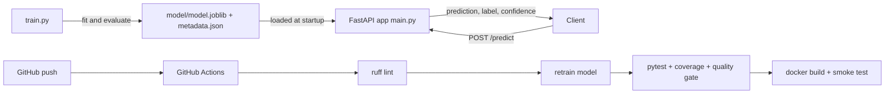

# ML Inference API — Breast Cancer Classification


A REST API that serves a scikit-learn model for classifying breast tumors as **malignant** or **benign**, built with **FastAPI**, containerized with **Docker**, and automatically linted, retrained, tested and built on every push via **GitHub Actions**.

## Highlights

- **Real ML model**: `StandardScaler + LogisticRegression` pipeline trained on the Wisconsin Diagnostic Breast Cancer dataset (569 samples, 30 features).
- **Typed and validated API**: Pydantic schemas reject wrong feature counts, non-numeric values, NaN/Inf, and oversized batches (HTTP 422).
- **Real confidence scores** from `predict_proba`, plus per-class probabilities.
- **Single and batch prediction** endpoints (up to 100 instances per request).
- **Observability**: request logging and an `X-Process-Time-Ms` response header.
- **Model quality gate in CI**: the build fails if a retrained model's accuracy or F1 drops below 0.93.
- **Production-oriented Docker image**: slim base, non-root user, built-in healthcheck.

## Model performance

Evaluated on a stratified 20% hold-out test set (114 samples), `random_state=42`:

| Metric | Score |
|---|---|
| Accuracy | 0.9825 |
| Precision | 0.9861 |
| Recall | 0.9861 |
| F1 | 0.9861 |
| ROC AUC | 0.9954 |
| 5-fold CV F1 (train set) | 0.9843 ± 0.0101 |

Run `python train.py` to reproduce. The numbers are also stored in `model/metadata.json` and returned by `GET /model/info`.

## Architecture



## Project structure

```
.
├── main.py               # FastAPI app: endpoints, schemas, model loading
├── train.py              # Trains the model and writes model/ artifacts
├── model/
│   ├── model.joblib      # Trained scikit-learn pipeline
│   └── metadata.json     # Version, feature names, metrics
├── test_main.py          # API, validation and model-quality tests
├── Dockerfile
├── requirements.txt      # Runtime dependencies
├── requirements-dev.txt  # + test / lint tools
├── pyproject.toml        # ruff and pytest config
└── .github/workflows/ci.yml
```

## Getting started

### Run locally

```bash
python -m venv .venv
# Windows: .venv\Scripts\activate    macOS/Linux: source .venv/bin/activate
pip install -r requirements-dev.txt

python train.py                 # optional: model/ is already committed
uvicorn main:app --reload
```

Open the interactive docs at http://localhost:8000/docs

### Run with Docker

```bash
docker build -t ml-inference-api .
docker run -p 8000:8000 ml-inference-api
```

### Run tests and lint

```bash
ruff check .
pytest --cov=main --cov-report=term-missing
```

## API

| Method | Endpoint | Description |
|---|---|---|
| GET | `/` | Basic liveness check |
| GET | `/health` | Health status, whether the model is loaded, model version |
| GET | `/model/info` | Feature names (in required order), classes, metrics |
| POST | `/predict` | Predict a single sample (30 features) |
| POST | `/predict/batch` | Predict 1–100 samples |

### Example request

```bash
curl -X POST http://localhost:8000/predict \
  -H "Content-Type: application/json" \
  -d '{"features": [17.99, 10.38, 122.8, 1001.0, 0.1184, 0.2776, 0.3001, 0.1471, 0.2419, 0.07871,
                    1.095, 0.9053, 8.589, 153.4, 0.006399, 0.04904, 0.05373, 0.01587, 0.03003, 0.006193,
                    25.38, 17.33, 184.6, 2019.0, 0.1622, 0.6656, 0.7119, 0.2654, 0.4601, 0.1189]}'
```

### Example response

```json
{
  "prediction": 0,
  "label": "malignant",
  "confidence": 1.0,
  "probabilities": { "malignant": 1.0, "benign": 0.0 }
}
```

## Limitations and next steps

- The dataset is small (569 samples) and well-studied; this project focuses on the **serving and MLOps workflow**, not on novel modeling. It is not a medical diagnostic tool.
- Next steps: experiment tracking with MLflow, deployment to a cloud host, monitoring for data drift, and pushing images to a container registry.

